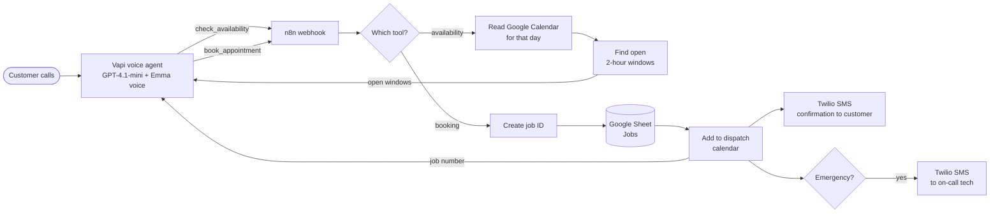

# AI Receptionist for Home Services Businesses

A 24/7 voice receptionist for plumbing, HVAC and electrical companies. It answers every call, checks the service area, looks up **real open slots on the dispatch calendar**, books the job, texts the customer a confirmation, and alerts the on-call technician for emergencies, all without a human picking up the phone.

**Built with:** Vapi · OpenAI GPT-4.1-mini · n8n · Google Calendar · Google Sheets · Twilio

---

## The problem

For home services companies, **a missed call is a missed job**:

- Technicians are on jobs and can't answer, and the office can't cover nights and weekends.
- Callers who reach voicemail ring the next company on Google.
- Office staff spend hours on the phone just to book appointments.
- Emergencies (burst pipes, no heat, gas smells) need a fast response at any hour.

## What this system does

| | |
|---|---|
| 📞 **Answers 100% of calls, 24/7** | No voicemail, no hold time |
| 📍 **Checks the service area** | Out-of-area ZIP codes are declined politely, so no wasted truck rolls |
| 📅 **Books real appointments** | Reads the live dispatch calendar and only offers 2-hour arrival windows that are actually free |
| 💬 **Confirms by SMS** | The customer gets a text with the date, arrival window and job number |
| 🚨 **Escalates emergencies** | Gas, flooding, sparking and no-heat calls get safety steps first, and the on-call tech gets an SMS immediately |
| 💵 **Answers common questions** | Service-call fee, hours, licensing, payment and financing, using only the facts you give it |
| 🗂️ **Logs every job** | Each booking is added to a Google Sheet and the dispatch calendar |

## How it works



### Call flow

1. **Needs:** what service is needed (plumbing, heating, cooling, electrical, water heater, drain) and what's wrong.
2. **Qualify:** name, callback number, address, and a ZIP code check against the service area.
3. **Availability:** the agent calls `check_availability`. n8n reads that day's calendar and returns only open windows.
4. **Book:** the customer picks a window, and the agent calls `book_appointment`. n8n logs the job, adds it to the calendar and texts the customer.
5. **Confirm:** the agent reads back the day, arrival window and job number.

See a full example in [docs/sample-call.md](docs/sample-call.md).

## Repository structure

```
├── agent/
│   ├── system-prompt.md                  # Persona, business facts, emergencies, booking flow, FAQs, rules
│   ├── assistant.json                    # Vapi assistant config (model, voice, transcriber)
│   └── tools/
│       ├── check-availability.json       # Tool: get open arrival windows for a date
│       └── book-appointment.json         # Tool: book the job
├── n8n/
│   └── home-services-booking-workflow.json  # Importable n8n workflow (13 nodes)
└── docs/
    ├── sample-call.md                    # Example booking call + what happens behind the scenes
    └── google-sheet-template.csv         # Column headers for the Jobs sheet
```

## Setup

**You'll need:** a Vapi account, an n8n instance, a Google account (Calendar + Sheets), and a Twilio number.

1. **Dispatch calendar:** create a Google Calendar for booked jobs and copy its calendar ID.
2. **Google Sheet:** create a sheet with a tab named `Jobs`, and paste the headers from `docs/google-sheet-template.csv` into row 1.
3. **n8n:**
   - Import `n8n/home-services-booking-workflow.json`.
   - Connect Google Calendar, Google Sheets and Twilio credentials.
   - Replace `YOUR_CALENDAR_ID`, `YOUR_GOOGLE_SHEET_ID` and the Twilio phone numbers.
   - In **Find open windows** and **Prepare booking**, set `TZ_OFFSET` to the business's time zone and adjust `WINDOWS` to its working hours.
   - In **Get booked jobs**, set the same time zone offset in `timeMin` and `timeMax`.
   - Activate the workflow and copy the production webhook URL.
4. **Vapi tools:** create both function tools from `agent/tools/`, and set each server URL to the n8n webhook.
5. **Vapi assistant:** create the assistant from `agent/assistant.json`, paste in `agent/system-prompt.md`, fill in the `{{...}}` business facts, and attach both tools.
6. **Phone number:** assign a Vapi number to the assistant, then forward the business line to it (all calls, after hours only, or when unanswered).
7. **Test:** book a standard job and an emergency. Check the calendar event, the sheet row and both texts.

## Customizing for a client

- **Business facts:** services, service-area ZIPs, hours, service-call fee, payment and financing all live in one section of the prompt.
- **Scheduling rules:** change window length, working hours, or jobs per window (for several technicians, allow overlapping bookings up to a crew count).
- **Field software:** swap Google Calendar and Sheets for ServiceTitan, Housecall Pro or Jobber. Only the n8n calendar and logging nodes change.
- **Follow-up:** add a review request the day after the job, or a reminder text the evening before.

## Contact

Built by **Muhammad Saeed ur Rehman**, business systems & automation builder.

📫 [saeedspace101@gmail.com](mailto:saeedspace101@gmail.com) · 💼 [LinkedIn](https://www.linkedin.com/in/muhammad-saeed-ur-rehman-57043724b)

Want a receptionist like this for your business? Get in touch.
